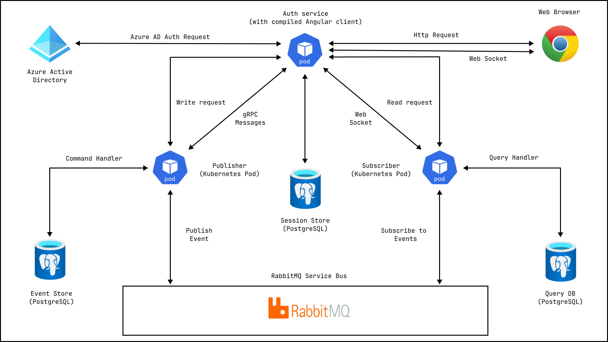
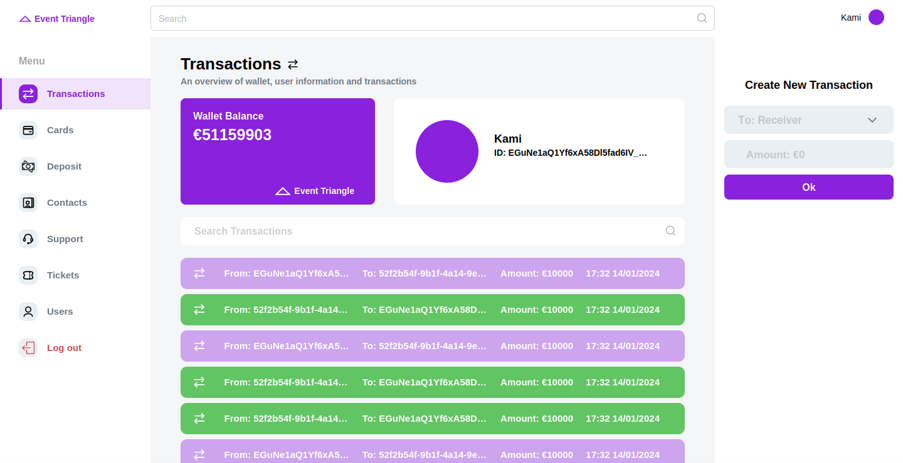
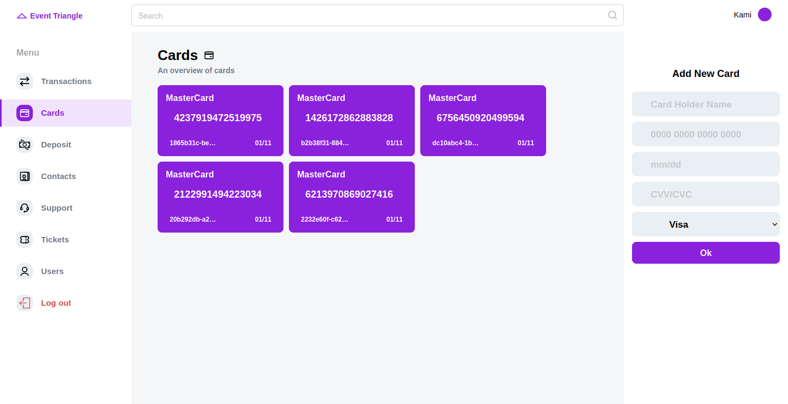
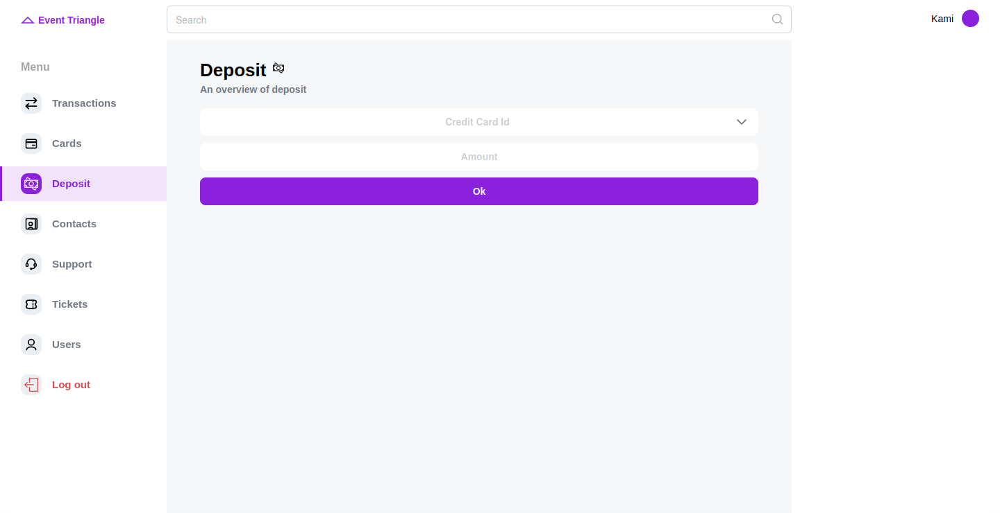
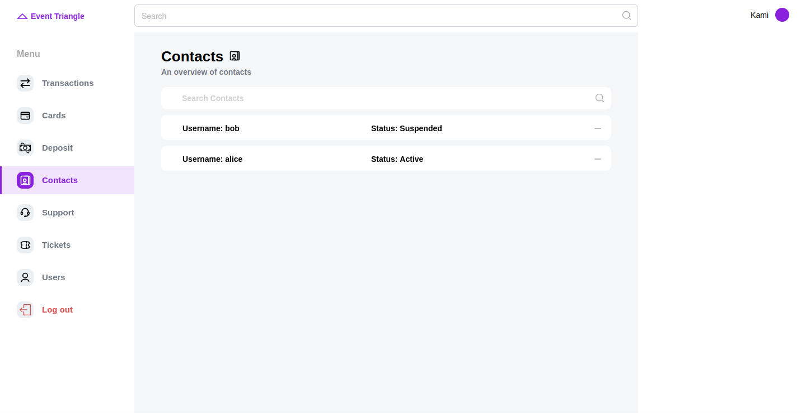
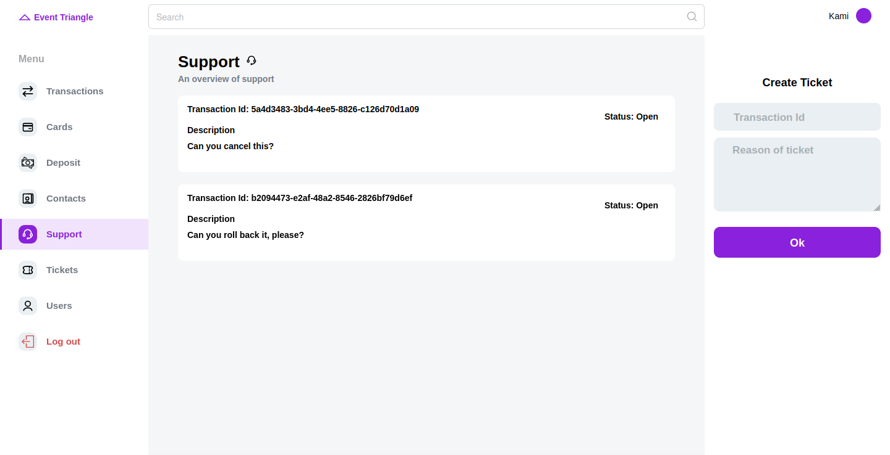
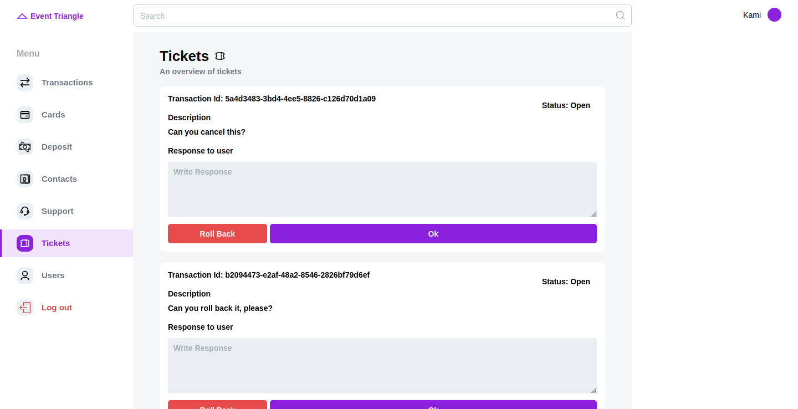
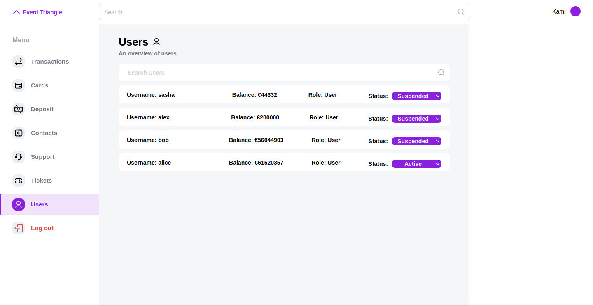

<p align="center">
  
</p>

<div align="center">
  <h1>EventTriangleAPI</h1>
</div>

Event Triangle is a project that leverages the power of event sourcing using
.NET and Angular frameworks to manage and track currency transactions. 
This project employs a cutting-edge approach to data storage and retrieval, capturing each state-changing event 
in the system to create a comprehensive and reliable transaction history. 
With a focus on real-time updates and seamless integration between the backend and frontend, 
EventTriangleAPI offers realtime communication using SignalR.

- **Video**: https://www.youtube.com/watch?v=9Deyui0g1RY

## Required Software

- **.NET SDK 10:** https://dotnet.microsoft.com/en-us/download
- **NVM for windows:** https://github.com/coreybutler/nvm-windows
- **Angular CLI:** `15.2.6`
- **NodeJS:** `18.15.0`
- **NPM:** `9.5.0`
- **Docker:** https://docs.docker.com/get-docker/
- **IDE**: Visual Studio or JetBrains Rider

## How to run in Debug mode

### Build Angular client

- Install NVM: `choco install nvm -y`
- Install NodeJS `18.15.0` using NVM & PowerShell as Administrator: `nvm install 18.15.0`
- Use NodeJS `18.15.0` using NVM via PowerShell as Administrator: `nvm use 18.15.0`
- Check NodeJS installed properly (should be `18.15.0`): `node -v`
- Check NPM installed properly (should be `9.5.0`): `npm -v`
- Go to the project folder: `cd src/authorization/EventTriangle.Client`
- Restore node modules: `npm ci`
- Install Angular CLI globally: `npm install -g @angular/cli@15.2.6`
- Open PowerShell as Administrator and type: `Set-ExecutionPolicy -ExecutionPolicy RemoteSigned`
- Check that Angular CLI installed properly: `ng version`
- Build project for development using Angular CLI: `ng build`
- Run angular client: `ng serve`

### Run required containers

- `docker run --name "event-auth-pgsql-db" -e POSTGRES_USER=postgres -e POSTGRES_PASSWORD=postgres -p 5432:5432 -d postgres:latest`
- `docker run --name=rabbit1 -p 5672:5672 -p 15672:15672 -e RABBITMQ_DEFAULT_USER=guest -e RABBITMQ_DEFAULT_PASS=guest -d rabbitmq:3-management`

### Run .NET Services in order

1. `Authorization service`
2. `Sender service`
3. `Consumer service`

## Infrastructure diagram

Setup: [Azure infrastructure](terraform/infrastructure/README.md),
[Azure DevOps](terraform/azure-devops/variable-groups/README.md),
[Cloudflare DNS](terraform/cloudflare/README.md).



## Technology stack

- **SDK:** `.NET 10`
- **Frameworks:** `ASP .NET Core`, `Angular 15`
- **Persistence:**
    - Database: `PostgreSQL 15`
    - ORM: `Entity Framework Core`
- **Authorization:** `Azure AD`
- **Presentation:**
    - API Documentation: `OpenAPI (Swagger)`
    - Realtime Communication: `SignalR`
    - Frontend Development: `Angular 15`
    - Microservices communication: `RabbitMQ`, `GRPC`
- **Unit and Integration Testing:** `XUnit`, `FluentAssertions`
- **Containerization:** `Docker`, `k8s`
- **Continuous Integration:** `Azure Pipelines`, `GitHub Actions`
- **Continuous Deployment:** `Azure Pipelines`, `GitHub Actions`, `Azure DevOps`, `Azure K8s Service`
- **Programming languages:** `C#`, `SQL`, `TypeScript`
- **Tools & IDE:** `Visual Studio`, `Rider`, `VS Code`, `WebStorm`, `SMSS`, `Postman`

## Useful links

### Deployments

- https://auth-eventtriangle.razumovsky.me/app/transactions
- https://auth-eventtriangle.razumovsky.me/swagger/index.html

### Management

- Docker: https://hub.docker.com/u/petrokolosov
- Azure DevOps: https://dev.azure.com/EventTriangle/EventTriangleAPI
- Renovate: https://developer.mend.io/github/EventTriangle/EventTriangleAPI
- SonarCloud: https://sonarcloud.io/organizations/event-triangle/projects

## How to run Docker compose

### Windows

- `setx EVENT_TRIANGLE_AD_CLIENT_SECRET <YOUR_AD_SECRET>`
- `docker-compose up`

### Linux

- `export EVENT_TRIANGLE_AD_CLIENT_SECRET=<YOUR_AD_SECRET>`
- `docker compose up`

## Build and publish Docker images

Requires Docker with Buildx and a Docker Hub token with write access to
`petrokolosov`. Set `DOCKERHUB_TOKEN` in your environment and run from the
repository root, using a unique version tag:

```bash
printf '%s' "$DOCKERHUB_TOKEN" | docker login docker.io --username petrokolosov --password-stdin
bash scripts/dockerhub/build-auth.sh 1.0.0-example
bash scripts/dockerhub/build-sender.sh 1.0.0-example
bash scripts/dockerhub/build-consumer.sh 1.0.0-example
docker logout docker.io
```

The scripts publish `auth-service`, `sender-service` and `consumer-service`
under `docker.io/petrokolosov` using the shared `scripts/docker-build.sh`. Each publishes
its version tag, `latest` and `buildcache`; subsequent builds reuse the registry
cache. Run application tests before publishing locally. The original
`scripts/build-*.sh` scripts publish to ACR.

### Azure Pipelines

Build and PR Validation use `.azdo/templates/docker-build-push-jobs.yml`: one
job restores/builds the solution, runs enabled checks, then logs in through
`Docker_Hub_Connection` and publishes the image. The hosted Ubuntu agent supplies
the .NET SDK.

- `shouldRunUnitTests` and `shouldRunIntegrationTests` control test execution.
  Auth unit tests are disabled because that project has no test cases.
- `sonarCloudEnabled` enables SonarCloud analysis on `main`; it defaults to `false`.
- Build CI runs for `main` and `v*` tags. Same-repository PRs and manual branch
  runs can also publish; fork PR publishing is disabled.

CI image tags combine GitVersion SemVer and the run ID, for example
`1.0.1-104-1666`. Find the version in the build number or Docker log and use it
for deployment or rollback. Version tags are immutable; `latest` and
`buildcache` are mutable.

Pipeline credentials and permissions: [Azure DevOps setup](terraform/azure-devops/variable-groups/README.md).

## Screenshots

### Transactions



### Credit Cards



### Deposit



### Contacts



### Support



### Tickets



### Users


